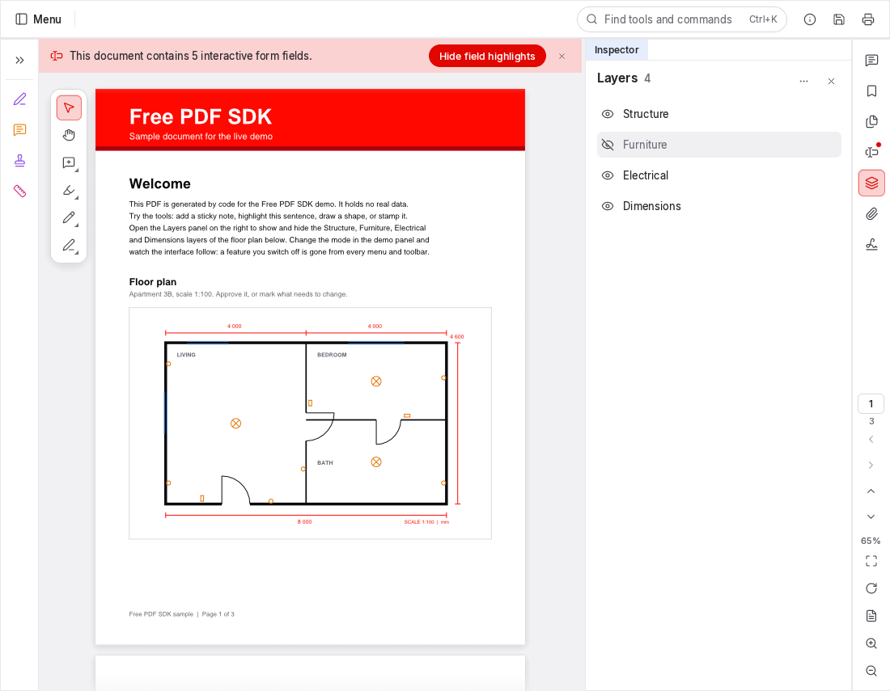
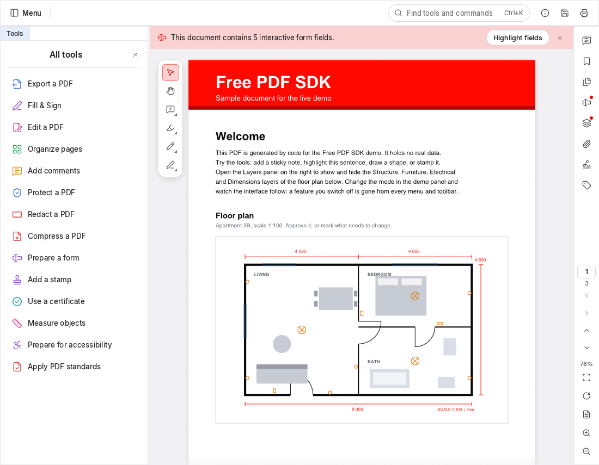
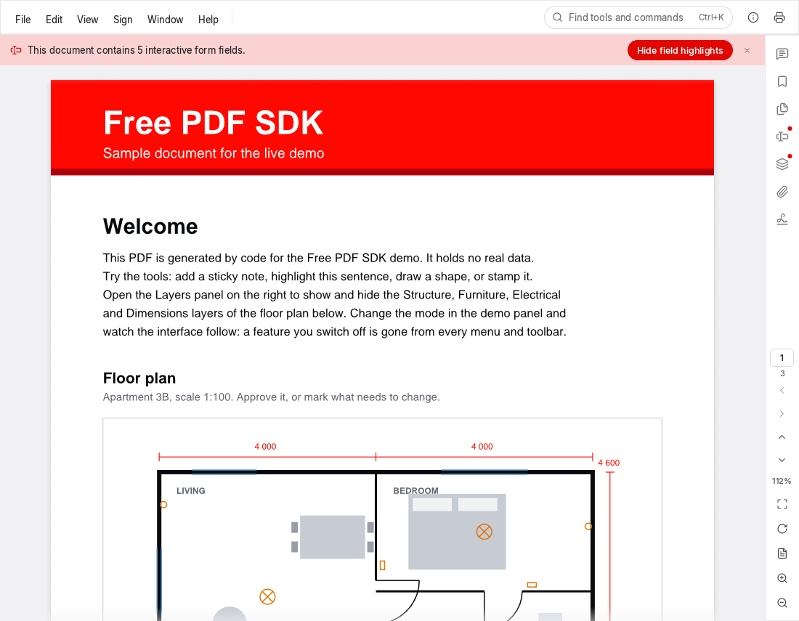

<p align="center">
  <picture>
    <source media="(prefers-color-scheme: dark)" srcset="brand/logo-dark.svg">
    
  </picture>
</p>

<h3 align="center">Show your users exactly what they need. Hide the rest.</h3>

<p align="center">
  A free, open-source, white-label PDF viewer, annotator and editor for the web.<br>
  Runs in the browser, so documents never leave your page.
</p>

<p align="center">
  <a href="https://www.npmjs.com/package/@mecorelabs/free-pdf-sdk"></a>
  
  <a href="https://freepdfsdk.mecorelabs.com/demo/"></a>
</p>

<p align="center">
  <a href="https://freepdfsdk.mecorelabs.com/"><b>Website</b></a> ·
  <a href="https://freepdfsdk.mecorelabs.com/demo/"><b>Live demo</b></a> ·
  <a href="https://freepdfsdk.mecorelabs.com/docs/getting-started/"><b>Get started</b></a> ·
  <a href="https://freepdfsdk.mecorelabs.com/docs/"><b>Docs</b></a>
</p>

<p align="center">
  <picture>
    <source media="(prefers-color-scheme: dark)" srcset="site/src/assets/img/viewer-layers-dark.png">
    
  </picture>
</p>

Your users switch PDF layers on and off with a click. You switch panels, tools and whole features
on or off, and every menu, toolbar and shortcut follows.

| 8 modes | 31 feature switches | 23 languages | 0 servers |
|:-:|:-:|:-:|:-:|
| from read-only to full authoring | each hidden everywhere when off | the whole interface, translated | documents stay on the device |

## Show a layer. Hide a layer. One click.

Structure, furniture, electrical, plumbing, dimensions, revisions: CAD exports keep them on PDF
layers. The Layers panel lists every layer in the drawing and switches it on or off, and the page
redraws instantly. Hide the furniture to show the client the shell as it will be built; keep only
structure and dimensions for a clean setting-out drawing. Printing follows what is shown; the file
itself is untouched.

## A complete PDF toolkit. Only the parts you switch on.

Every capability is a feature flag. Leave one off and it disappears from the toolbars, the menus,
the right-click menus and the keyboard shortcuts: gone, not greyed out.

| | |
|---|---|
| **Comments & review** | Notes, callouts, highlights, shapes, ink and stamps, with replies and review status. Standard XFDF in and out. |
| **Measurement** | Distance, perimeter and area with a drawing scale. |
| **Forms, Fill & Sign** | Fill fields, tick boxes, add dates and drawn or typed signatures. Design forms in edit mode. |
| **Page organization** | Insert, delete, rotate, reorder, duplicate, crop, replace and number pages. |
| **Redaction** | Mark, apply and sanitize. Hidden information is removed, not covered. |
| **Signature validation** | See who signed a file, when, and whether every signature still checks out. |
| **Private by design** | WebAssembly in an iframe on your own origin. No server, no uploads, no tracking. AES-256 encrypted files open in place, and an owner password lifts their restrictions. |
| **White-label** | Light, dark and system themes at runtime. Build from source to compile in your name, logo and accent colour. |
| **23 languages** | Pick a locale or follow the browser. |

Also: export to Word, images and HTML · PDF/A · accessibility checker · bookmarks · attachments ·
watermarks & Bates numbers · flatten · print · search · undo & redo.

## One option. The right interface.

Pick a mode, then fine-tune it. The same viewer in `full` mode and in `view` mode:

<table>
  <tr>
    <td width="50%"><picture><source media="(prefers-color-scheme: dark)" srcset="site/src/assets/img/viewer-full-dark.png"></picture></td>
    <td width="50%"><picture><source media="(prefers-color-scheme: dark)" srcset="site/src/assets/img/viewer-view-dark.png"></picture></td>
  </tr>
  <tr><td align="center"><code>mode: "full"</code></td><td align="center"><code>mode: "view"</code></td></tr>
</table>

Modes: `view`, `review`, `annotate`, `fill`, `sign`, `organize`, `edit`, `full`. The full list
of modes, features and interface options is in
[docs/reference/config.json](docs/reference/config.json) and on the
[configuration page](https://freepdfsdk.mecorelabs.com/docs/configuration/).

## Three steps to a working viewer

```bash
npm install @mecorelabs/free-pdf-sdk                          # 1. install
npx @mecorelabs/free-pdf-sdk copy-viewer public/free-pdf-sdk  # 2. serve the viewer files from your origin
```

```ts
// 3. mount it
import { FreePdf } from "@mecorelabs/free-pdf-sdk";

const viewer = await FreePdf.init(document.getElementById("viewer")!, {
  baseUrl: "/free-pdf-sdk/",
  mode: "annotate",
  features: { stamps: false, measurement: false },
  ui: { panels: { layers: true } },
  author: "Ada Lovelace",
  document: { url: "/files/plan.pdf" },
});

viewer.on("annotationsChanged", ({ count }) => console.log(count, "comments"));
const xfdf = await viewer.exportXfdf();      // store it anywhere; importXfdf() brings it back
```

The viewer is a WebAssembly app in an iframe on your own origin. A small typed wrapper talks to
it over a versioned postMessage protocol, so your code stays simple and your page stays isolated.

## Drop it into the framework you already use

| | |
|---|---|
| React | `import { FreePdfViewer } from "@mecorelabs/free-pdf-sdk/react"` ([guide](https://freepdfsdk.mecorelabs.com/docs/react/)) |
| Vue | `import { FreePdfViewer } from "@mecorelabs/free-pdf-sdk/vue"` ([guide](https://freepdfsdk.mecorelabs.com/docs/vue/)) |
| Svelte | `import { freePdf } from "@mecorelabs/free-pdf-sdk/svelte"` ([guide](https://freepdfsdk.mecorelabs.com/docs/svelte/)) |
| Angular and everything else | `<free-pdf-viewer>` from `@mecorelabs/free-pdf-sdk/element` ([Angular](https://freepdfsdk.mecorelabs.com/docs/angular/), [Web Component](https://freepdfsdk.mecorelabs.com/docs/web-component/)) |
| Plain JavaScript | `FreePdf.init()` from `@mecorelabs/free-pdf-sdk` ([guide](https://freepdfsdk.mecorelabs.com/docs/vanilla-js/)) |

One npm package, fully typed.

## Documentation

The docs live at **[freepdfsdk.mecorelabs.com/docs](https://freepdfsdk.mecorelabs.com/docs/)**: guides for
every framework, the full API reference and recipes for common setups. Every page is also plain
Markdown for AI coding assistants, indexed in
[/llms.txt](https://freepdfsdk.mecorelabs.com/llms.txt), with a
[JSON Schema](https://freepdfsdk.mecorelabs.com/schema/viewer-options.schema.json) of the options.

In this repository:

| | |
|---|---|
| [site/](site/README.md) | The website and its docs ([site/src/docs/](site/src/docs/)) |
| [docs/reference/config.json](docs/reference/config.json) | Modes, features, interface options, element ids (generated, tested) |
| [docs/architecture.md](docs/architecture.md) | How it is built, the RPC protocol, the pdfcraft patches |
| [docs/updating-upstream.md](docs/updating-upstream.md) | Taking new pdfcraft releases |

## Building from source

Free PDF SDK is [pdfcraft](https://github.com/storytold/pdfcraft) (Rust) compiled to WebAssembly.
Requirements: Rust (stable, with the `wasm32-unknown-unknown` target), Node 20+, and
`wasm-bindgen-cli` at the version in `Cargo.lock`:

```powershell
rustup target add wasm32-unknown-unknown
cargo install wasm-bindgen-cli --version 0.2.129 --locked
npm ci; npm --prefix js ci
npm run build:sdk      # -> dist/free-pdf-sdk-<version>/ and dist/npm/
npm run build:site     # -> site/public/ (the website, with the SDK and the live demo)
```

While the pdfcraft fork commit named in `Cargo.lock` is not yet pushed, use
`npm run build:sdk:local-fork` (see [docs/updating-upstream.md](docs/updating-upstream.md)).

| Script | Does |
|---|---|
| `npm run dev:example` | The example page at http://127.0.0.1:8780/ (`?mode=view`, `?theme=dark`, `?doc=protected-aes256-owner.pdf`) |
| `npm run preview:site:dev` | The built website, locally |
| `npm run test:e2e` | Browser tests (after a build); Rust: `cargo test -p fps-core -p fps-brand -p fps-tests` |
| `npm run deploy:hosting:prod` | Builds and deploys the website |
| `npm run publish:npm:prod` | Publishes `dist/npm` as `@mecorelabs/free-pdf-sdk`, signing in through the browser (passkey); run it in an interactive terminal (`check:npm-package:dev` for a dry run) |

### Branding

The name, logos, accent colours and About text come from [brand/](brand/README.md). Replace the
SVGs and `brand/brand.toml`, then rebuild.

## Support the project

Free PDF SDK is open source, built on the pdfcraft engine by the ArtCraft Team. Donations pay for
the work on top: bringing in each new engine release, keeping the SDK and its framework
integrations working, testing new browser versions, fixing bugs and keeping the docs current.

<a href="https://ko-fi.com/K4V228W28L"></a>

## Licence

Free PDF SDK is licensed under either of [MIT](LICENSE-MIT) or [Apache-2.0](LICENSE-APACHE) at
your option. It is based on pdfcraft (MIT OR Apache-2.0); see [NOTICE](NOTICE) and
[third-party/](third-party/README.md) for pdfcraft's licence and the fonts, icons and data the
viewer embeds. "PdfCraft" and "ArtCraft" are trademarks of the ArtCraft Team; this project is not
affiliated with or endorsed by them.
